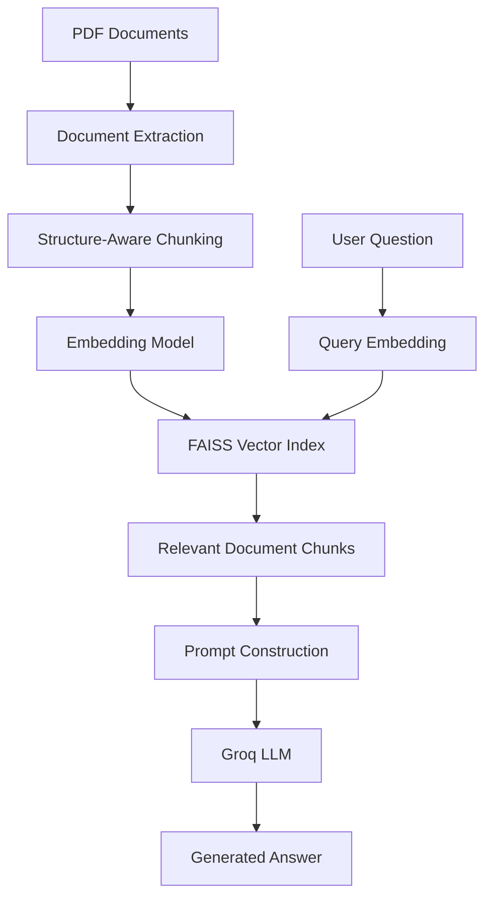

# Lauki Phones — RAG Customer Support Assistant

A Retrieval-Augmented Generation (RAG) system that answers customer-support questions using information extracted from Lauki Phones PDF documents. The project includes a retrieval evaluation pipeline to measure how effectively relevant document chunks are retrieved for a given question.

## 1. Project Overview

Customer-support information is often distributed across multiple documents. Manually searching these documents for every query can be time-consuming.

This project builds a RAG pipeline that retrieves relevant information from a small document collection and provides it to a Large Language Model (LLM) to generate a context-grounded answer.

The system currently supports questions about topics such as:

- Mobile plans and pricing
- Network coverage and 5G availability
- Billing and late-payment fees
- Data usage and service restoration
- Refunds and plan switching

The answers are based on the supplied knowledge base. The LLM is instructed to avoid inventing information when the retrieved context does not contain a sufficient answer.

## 2. System Architecture

The main pipeline consists of document extraction, chunking, embedding generation, vector search, and answer generation.



### How the pipeline works

1. **Document extraction:** Extract text and metadata, including source filename and page number, from PDF files.
2. **Chunking:** Divide extracted text into smaller, meaningful sections that can be retrieved independently.
3. **Embedding generation:** Convert each chunk into a numerical vector using Sentence Transformers.
4. **Vector indexing:** Store the vectors in a FAISS index for similarity-based retrieval.
5. **Query processing:** Convert the user's question into an embedding using the same embedding model.
6. **Retrieval:** Retrieve the most similar document chunks using FAISS.
7. **Answer generation:** Include the retrieved text in a prompt and send it to a Groq-hosted LLM.
8. **Grounded response:** Instruct the LLM to answer from the provided context and acknowledge when the information is insufficient.

## 3. Technology Stack

| Component | Technology |
|---|---|
| Programming language | Python |
| PDF extraction | PyMuPDF |
| Embeddings | Sentence Transformers |
| Embedding model | `all-MiniLM-L6-v2` |
| Numerical operations | NumPy |
| Vector search | FAISS |
| LLM inference | Groq API |
| LLM model | `openai/gpt-oss-20b` |
| Configuration and secrets | `python-dotenv` |
| Version control | Git and GitHub |

## 4. Project Structure

```text
voice_agent/
├── app.py
├── extract_documents.py
├── chunking.py
├── embeddings.py
├── vector_store.py
├── rag.py
├── evaluate_retrieval.py
├── evaluation_dataset.json
├── evaluation_results/
│   ├── experiments.csv
│   └── query_results.csv
├── lauki-billing-faq.pdf
├── lauki-network-coverage.pdf
├── lauki-plans.pdf
├── .env                 # Local only; not committed
├── .gitignore
└── README.md
```

The `.venv/` directory is also local and should not be committed. A dependency file such as `requirements.txt` can be added to make environment setup reproducible.

### Main modules

- **`app.py`** — Connects the document-processing, retrieval, and answer-generation components into an interactive application.
- **`extract_documents.py`** — Loads PDF files and extracts page-level text with source metadata.
- **`chunking.py`** — Splits extracted documents into smaller logical chunks.
- **`embeddings.py`** — Generates document and query embeddings.
- **`vector_store.py`** — Builds the FAISS index and retrieves the top matching chunks.
- **`rag.py`** — Constructs the context prompt and calls the Groq LLM to generate an answer.
- **`evaluate_retrieval.py`** — Evaluates retrieval quality using labelled questions and relevant chunk IDs.
- **`evaluation_dataset.json`** — Stores evaluation questions, expected answers, answerability labels, relevant sources, and relevant chunk IDs.
- **`evaluation_results/`** — Stores aggregate experiment metrics and per-question retrieval results.

## 5. Prerequisites

Before running the project, install:

- Python compatible with the dependencies used by the project
- Git
- VS Code (optional, but useful for development)
- A Groq API key

The project has been tested in a local Windows virtual environment. Exact dependency versions should be pinned in the project's dependency file for reproducible installations.

## 6. Setup and Installation

### Step 1: Clone the repository

```bash
git clone <YOUR_GITHUB_REPOSITORY_URL>
cd voice_agent
```

Replace the placeholder with the actual repository URL.

### Step 2: Create a virtual environment

On Windows PowerShell:

```powershell
uv venv
.venv\Scripts\Activate.ps1
```

If `uv` is not installed, install it first or use Python's built-in `venv` module.

### Step 3: Install dependencies

If the repository contains a `requirements.txt` file:

```powershell
uv pip install -r requirements.txt
```

Ensure that the dependency file includes the libraries required by the current code, including `groq`, `python-dotenv`, `sentence-transformers`, `numpy`, `faiss-cpu`, and `pymupdf`.

### Step 4: Configure the API key

Create a local `.env` file in the project root:

```dotenv
llm_api_key=YOUR_GROQ_API_KEY
```

Replace the placeholder with your own key. Never commit the `.env` file or publish API credentials.

### Step 5: Add the knowledge-base documents

Place the three PDF documents in the project root, using the filenames expected by `extract_documents.py`:

- `lauki-billing-faq.pdf`
- `lauki-network-coverage.pdf`
- `lauki-plans.pdf`

Only distribute these documents if you have permission to publish them.

## 7. Running the Application

Activate the virtual environment and run:

```powershell
python app.py
```

The application loads the documents, creates chunks, generates embeddings, builds the vector index, and uses retrieval results as context for LLM responses.

The current implementation rebuilds the index when the application starts. Persistent index storage and incremental updates can be considered as future improvements.

## 8. Retrieval Evaluation

A RAG system needs more than a few successful demonstrations. Its retrieval component should be evaluated against a fixed dataset of questions with known relevant chunks.

The project uses `evaluation_dataset.json` as the reference dataset. Answerable questions have labelled relevant chunk IDs, which are compared against the chunks returned by the retriever.

### Evaluation configuration

| Parameter | Baseline value |
|---|---|
| Embedding model | `all-MiniLM-L6-v2` |
| Embedding dimension | 384 |
| Chunk size | 700 characters |
| Line overlap | 2 lines |
| Retrieval method | FAISS inner-product search on L2-normalized vectors |
| Top-K values | 1, 3, 5 |
| Reranker | None |
| Total chunks | 41 |
| Answerable evaluation questions | 13 |

### Metrics

**Recall@K**

Measures the proportion of labelled relevant chunks retrieved within the top K results. Higher recall means more of the expected evidence was retrieved.

**Mean Reciprocal Rank (MRR)**

Measures the rank of the first relevant retrieved chunk. A higher MRR indicates that relevant evidence tends to appear closer to the top of the result list.

Unanswerable questions with no relevant chunk IDs are excluded from these retrieval metrics. Their refusal and abstention behaviour should be evaluated separately.

### Baseline results

The first recorded retrieval evaluation produced the following results:

| Top-K | Recall@K | MRR |
|---|---:|---:|
| 1 | 0.641 | 0.692 |
| 3 | 0.769 | 0.808 |
| 5 | 0.821 | 0.823 |

These results form the initial baseline for future experiments. They are dependent on the current documents, chunking configuration, evaluation dataset, and relevance labels.

Increasing K improves recall in this run because more candidate chunks are considered. However, retrieving more chunks can also introduce irrelevant context. The best production configuration should be chosen after evaluating answer quality and latency as well as retrieval metrics.

### Running the evaluation

```powershell
python evaluate_retrieval.py
```

The script rebuilds the retrieval pipeline, evaluates the configured top-K values, and appends results to:

- `evaluation_results/experiments.csv` — aggregate metrics for each run and configuration.
- `evaluation_results/query_results.csv` — retrieval results and metrics for individual questions.

Keep the evaluation dataset fixed when comparing experiments. If documents or chunking rules change, review and update the relevant chunk labels before interpreting the new scores.

## 9. Experiment Tracking

The evaluation CSV files provide a record of experiments over time. When testing improvements, record the configuration alongside the metrics.

Useful experiment parameters include:

- Embedding model
- Chunking strategy and chunk size
- Overlap settings
- Top-K value
- Reranking configuration
- LLM and prompt version
- Retrieval and generation latency
- Evaluation dataset version

Change one major variable at a time when possible. This makes it easier to determine which change caused an improvement or regression.

## 10. Security and Limitations

- The LLM is instructed to answer using retrieved context, but prompt instructions alone cannot guarantee factual correctness.
- Retrieval quality depends on the documents, chunk boundaries, embedding model, and relevance labels.
- The current baseline evaluates retrieval, not the full correctness and faithfulness of generated answers.
- The current implementation rebuilds the vector index at application startup.
- API credentials must remain in local environment variables and must not be committed.
- The knowledge-base documents should only be published when their distribution is permitted.

## 11. Future Improvements

Planned development areas include:

1. **Answer evaluation:** Measure answer correctness, faithfulness, and appropriate abstention.
2. **Chunking experiments:** Compare the existing chunking strategy with alternative fixed-size, semantic, and structure-aware strategies.
3. **Reranking:** Evaluate a reranker to improve the ordering of retrieved chunks.
4. **Retrieval improvements:** Experiment with embedding models, metadata filtering, and retrieval parameters.
5. **Observability:** Add more detailed experiment tracking, latency measurement, and failure analysis.
6. **Voice interface:** Integrate speech-to-text and text-to-speech components after the text-based RAG pipeline is evaluated.

Each improvement should be evaluated against the same baseline dataset whenever the underlying evaluation labels remain valid.

## 12. Reproducibility

For meaningful comparisons, preserve the baseline source code, evaluation dataset, relevance labels, configuration, and result files. If chunking or source documents change, update the labels and record a new dataset version.

Use Git commits to document each significant experiment and its outcome.

## License

Add an appropriate license before distributing this repository publicly. Ensure that any included PDF documents and other third-party materials can legally be redistributed.
